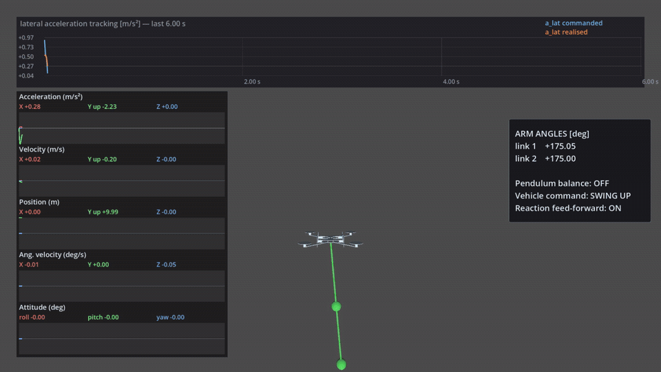

# Inverted-pendulum drone

I designed and implemented a fully actuated eight-rotor drone and control stack that can swing a
double inverted pendulum up from hanging, catch it, and hold it upright. The system is validated
in simulation: portable, flight-targeted C++ runs against a custom Godot/Jolt physics plant with
motor dynamics, aerodynamic drag, sensor noise, and measurement latency. The physical airframe
has not been built yet.

## Demonstration



*The complete 18-second demonstration plays above. For maximum detail,
[download the full-resolution H.264 video](https://github.com/OmicronTheta2338/inverted-pendulum-drone/raw/refs/heads/main/assets/drone-demo.mp4).*

One continuous run shows the double-pendulum swing-up and catch, a stable upright hold, and the
vehicle pre-emptively opposing the hinge reaction as the released arms fall.

## What the demonstration shows

The video combines three tests of the same portable C++ control stack:

1. **Swing-up and catch.** A double pendulum has two coupled modes, so the scalar energy-pumping
   method that worked for one arm could not control where the energy went. I replaced it with an
   iLQR-optimised trajectory tracked by TVLQR, plus a state gate that hands over to LQR balance.
   Both links start hanging, reach the catch region at about 3.5 seconds, and settle upright.
2. **Stable balance.** An ordinary quadcopter moves sideways by tilting, which would also tilt
   the pendulum base. Four upright and four lateral motors instead let the MIMO LQR move the base
   sideways while the body stays level, using noisy, delayed arm and vehicle measurements.
3. **Pre-emptive reaction-force compensation.** Pendulum balancing is then deliberately disabled,
   the vehicle is told to hold steady, and the arms fall freely. Rather than wait for their hinge
   reaction to create an acceleration error, the controller predicts it from the measured link
   states and commands opposing thrust. The fall is intentional; the small vehicle disturbance
   is the result. This feed-forward reduces it by about 2.2×.

## The control problem

Latency was the binding constraint: a double inverted pendulum diverges fast enough that tens of
milliseconds erode its control margin. My first architecture connected real ArduPilot SITL to
Godot over UDP, but the bridge added 20–40 ms of dead time. I ported the acceleration mode,
attitude control, and mixer into an in-process, dependency-free C++ core. It now realises a
command within 5% in about 15 ms and is intended to compile onto the H743 flight controller.

The narrow interface between layers keeps the solution testable: the inner loop treats the level
vehicle as a cart and converts acceleration demands into motor thrust; the outer loop handles
swing-up and balance. Simulator-specific code never enters the flight-targeted controller.

## What the simulation includes

The main double-pendulum plant is a full rigid-body simulation rather than an idealised cart. It
currently accounts for:

- **Vehicle and pendulum dynamics:** gravity; six-degree-of-freedom motion; specified mass, centre
  of mass and inertia; each motor's position, thrust axis and spin; motor force and reaction
  torque; coupled hinge reactions; and distributed rod-and-tip arm mass, centre of mass and
  inertia.
- **Actuators and electrical limits:** maximum thrust, nonlinear propeller curve and saturation;
  asymmetric spin-up/spin-down lag; shared-battery voltage sag; fixed-pitch propeller unloading
  with axial airspeed; and rotor gyroscopic torque.
- **Aerodynamic and mechanical losses:** quadratic body and bob drag, viscous bearing friction,
  and smoothed Coulomb friction representing dry friction and stiction at both hinges.
- **IMU and state-estimation errors:** gyroscope white noise and bias random walk; accelerometer
  white noise; throttle-dependent rotor vibration whose amplitude and frequency rise with thrust;
  attitude, velocity and position noise; and IMU-only position dead-reckoning drift.
- **Arm sensing:** noisy two-IMU fused angle and differential-gyro rate for the first arm; a
  low-passed acceleration-coupled angle bias; second-joint magnetic-encoder noise, quantisation
  and differentiated-rate noise; and reconstruction of the second link's absolute state.
- **Timing:** independent latency for raw IMU data, estimated attitude, velocity, position,
  first-arm fused angle, arm rate and encoder channels, with motor and sensing delays inside the
  fixed-rate closed loop.

Coefficients remain conservative estimates until bench measurement. Prop-wash CFD and vibration
aliasing above the 400 Hz sensor simulation are explicit hardware-validation items, not modeled
claims.

| Capability | Measured result | Why it matters |
|---|---|---|
| Acceleration response | Within 5% of the command in about 15 ms | The vehicle can move the pendulum's base before the unstable mode grows too far. |
| Double-pendulum balance | 8/8 noisy Monte Carlo runs passed | Balance is repeatable across randomised sensor noise, not tuned to one run. |
| Swing-up, catch, and hold | 6/6 runs passed; catch at about 3.5 s and hold for more than 13 s | The controller completes the full manoeuvre from hanging rather than starting near upright. |
| Delay margin | Failure near 70 ms total effective delay versus 25–30 ms nominal | The simulated system has roughly 2.5× timing margin before losing stability. |

## Current status

**Next hardware milestone:** fly the base drone without the pendulum. Follow the
[base-drone flight checklist](Base-Drone-Flight-Checklist.md), with flight software preparation
as the immediate priority.
The [firmware build and flashing guide](firmware/README.md) provides the pinned ArduPilot
ALT_HOLD build with the embedded eight-motor mixer for props-off commissioning.

The acceleration loop, reaction-force compensation, single- and double-pendulum balance, and
double swing-up all pass in simulation under the noise and latency model. A triple pendulum also
balances in an isolated stretch-goal sandbox. The airframe currently exists as rough parametric
CAD; detailed CAD, construction, and hardware bring-up are the next phase. The sections below
document the architecture, repository layout, representative runs, and the design record behind
the results.

## How it fits together

```
balance / swing-up controller   (portable C++: LQR, iLQR + TVLQR)
        │  commanded lateral accel  a_cmd  [m/s²]
        ▼
ModeAccel   (portable C++: overdrive FF + drag-cancel + reaction FF)
        │  per-motor thrust  →  8-rotor 6DOF mixer
        ▼
Godot / Jolt plant   (hinged series double pendulum, motor lag, aero)
        │  true state
        ▼
sensor harness   (per-channel Gaussian noise + latency ring buffers)
        │  noisy, delayed measurement
        └───────────────────────────────────────►  back to the controller
```

The control layers are portable C++ with no Godot or ArduPilot dependencies — the artifact that
compiles onto the flight controller. Noise and latency live in the Godot harness and never in
the shipped code: on the real vehicle they *are* the hardware. Two paths drive the plant: the
native in-process stack (the validated one, no bridge latency) and the original
ArduPilot-SITL-over-UDP bridge, kept as a reference.

## Repo map

| Path | What's there |
|---|---|
| `native/src/` | Portable control core: `mode_accel` (accel loop + FF), `arm_balance_controller` / `two_arm_balance_controller` / `three_arm_balance_controller` (LQR balance), `swingup*_controller` (swing-up), `ap_motors6dof` (8-rotor 6DOF mixer), `ap_attitude_control`. The `gdext_*` files are the Godot bindings. |
| `native/tools/` | Offline math: `compute_lqr*.py` (Riccati / LQR gains), `swingup2_traj.py` (iLQR trajectory opt), plotting. numpy only, no scipy. |
| `native/tests/` | Pure-C++ plant and flight-stack tests, plus the Monte-Carlo balance sweep. |
| `sim-v-1/` | The Godot project: `main.gd` / `main.tscn` (double), `main3.*` (triple), and the idealised-cart harnesses `balance*_test` and `swingup*_test`. |
| `sitl/` | The ArduPilot SITL bridge path: Lua rig scripts, params, autotest harness. |
| `CAD/` | Rough parametric body (`body-rough-v1.stl`). |
| `*.md` (root) | The design record — see below. |

## Build and run

The control core builds against godot-cpp (4.5) as a GDExtension:

```
git clone --depth 1 --branch 4.5 https://github.com/godotengine/godot-cpp.git native/godot-cpp
cd native && scons -j$(nproc) use_static_cpp=no      # the .so lands in sim-v-1/bin/
```

A few representative runs, all headless-capable:

```
# double inverted pendulum, balance on the real native stack, noise on
USE_NATIVE=1 NUM_ARMS=2 BALANCE_ONBOARD=1 USE_SENSOR_NOISE=1 \
    godot --headless --path sim-v-1 res://main.tscn

# double swing-up from hanging → catch → hold
USE_NATIVE=1 NUM_ARMS=2 SWINGUP=1 USE_SENSOR_NOISE=1 SENSOR_SEED=1 \
    godot --headless --path sim-v-1 res://main.tscn

# fast pure-C++ balance validation, no Godot
cd native/tests && g++ -O2 -std=c++17 -I../src \
    test_plant_main.cpp ../src/arm_balance_controller.cpp -o test_plant && ./test_plant
```

Native simulations enable the sensor model by default (`USE_SENSOR_NOISE=0` selects
an ideal-truth baseline). Position and velocity initialize from the starting state,
then integrate the same noisy, vibrating earth-frame IMU specific force used by
the controller, with NED gravity compensation. Their configured channel latencies
apply to these integrated estimates. There is no ongoing truth correction or
external position aiding, so IMU errors accumulate into navigation drift. The old
independent position/velocity noise and `SENSOR_POS_DRIFT` switch are removed.
This is an IMU dead-reckoning model, not a complete EKF: attitude remains a
separate simplified noisy-truth model, and accelerometer bias is not yet modeled.
The SITL path continues to use ArduPilot's own sensor/estimator pipeline.

In the native scenes, arm 1 now uses a planar two-IMU complementary observer.
Local arm accelerometer measurements come from the world motion of a point on
the rod, including pivot, tangential, and centripetal acceleration. Independent
accelerometer noise and gyro noise/bias random walks enter the observer before
angle integration and gravity correction. It has no access to true arm angle or
rate. Strong dynamic loads gate gravity correction; moderate sustained loads
can still bias it. The default mount is 0.10 m from the proximal pivot
(`arm_imu_distance`); set this and `sig_arm_accel`, `sig_arm_gyro_dps`, and
`arm_observer_tau` from the actual hardware. Startup assumes stationary sensors
for the first two samples while position-difference history fills. Differencing
adds about one physics tick of acceleration lag. This remains a planar observer,
not a calibrated full-3D hardware estimator; arm vibration transfer and thermal
accelerometer bias are not modeled. Downstream joint rates now differentiate
noisy, quantized encoder readings with `encoder_rate_tau` filtering.

Arm sensing regressions:
`godot --headless --path sim-v-1 --script res://tests/test_arm_imu.gd`.


Run the navigation regression checks with:
`godot --headless --path sim-v-1 --script res://tests/test_sensor_navigation.gd`.

The interactive scenes (`res://balance2_test.tscn`, `res://swingup2_test.tscn`) draw live
accel and angle strip-charts. Env knobs and the full run matrix live in the design docs.

### Recording overlays

The default `main.tscn` run is arranged for a general demonstration video: one lateral
command/realised chart at the top, the existing telemetry set at the bottom, and numeric arm
angles at the right. The middle of the frame is reserved for the drone.

For a separate arm-release response recording, enable **Response Video Overlay** on the scene's
`Main` node or launch with:

```
cd sim-v-1
RESPONSE_VIDEO=1 godot --path .
```

This replaces the single top chart with side-by-side lateral and vertical
commanded-versus-realised acceleration charts. Both retain six seconds of data, mark the arm
release, and continue sampling while the arms fall.

The default top-chart window is six seconds. It can be changed in the `Main` inspector through
**Graph Window Seconds**, or for one run with `GRAPH_WINDOW_SECONDS=8`.

The angle panel also states whether pendulum balance is active, whether the vehicle is swinging
up, balancing, or holding position, and whether reaction feed-forward is currently active.

To generate a synchronized side-by-side post-release comparison:

```
bash sim-v-1/tools/render_ff_comparison.sh
```

The script records two deterministic balance runs. Reaction feed-forward is enabled in both until
the arms are released; only then does one run disable it. It trims around the common release time
and writes `sim-v-1/recordings/ff-comparison/reaction_ff_comparison.mp4`, with the FF-on and FF-off
versions labelled side by side. Both arms are always enabled for these recordings. `GODOT_BIN`,
`COMPARISON_FPS`, and `COMPARISON_DURATION` can be overridden through the environment.

## Design docs

The real depth is written down. Each of these stands on its own:

- **`Phase-0-Research.md`** — the flight-controller decision: build from scratch vs extend
  ArduPilot, and how lateral force is represented in the 6DOF path.
- **`Phase-1-Research.md`** — layout and the analytical performance budget.
- **`Project-Plan.md`** — the full phase plan, simulation through hardware.
- **`Balance-Controller-Design.md`** — the cart abstraction, the LQR design, the RHP-pole delay
  budget, single and double results.
- **`Native-Flightstack-Plan.md`** — retiring the SITL bridge for the in-process stack: the
  accel-mode spec, the reaction FF, and the packet-by-packet validation up to the balance
  capstone.
- **`Swingup-Double-TrajOpt.md`** — iLQR plus TVLQR swing-up for the double.
- **`Sensor-Requirements-BoM.md`** — sensor selection and the noise/latency model.
- **`Model-Fidelity-Notes.md`** — where the sim still diverges from the real vehicle, tracked so
  it can be closed in one accuracy sweep.
